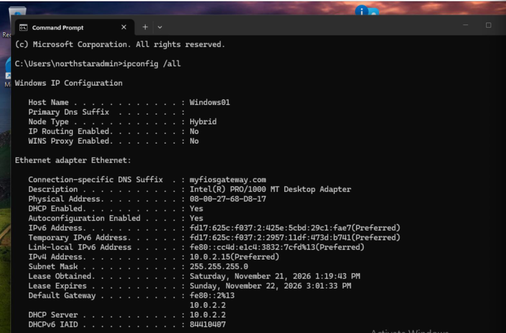

# INC-001 — Network Connectivity Failure

## Ticket Information
- **Environment:** Windows01 — Windows 11 Pro, Oracle VirtualBox
- **Category:** Network Connectivity
- **Priority:** Medium (simulated)
- **Status:** Resolved

## Problem Description
A simulated employee reported being unable to access websites using Google Chrome or Microsoft Edge.

## Troubleshooting Process
1. Ran `ipconfig` and observed no active network adapter configuration.
2. Ran `ipconfig /all` to investigate network configuration.
3. Opened Network Connections using `ncpa.cpl`.
4. Identified the Ethernet adapter as disabled.
5. Enabled the Ethernet adapter.
6. Ran `ipconfig` to verify the restored IP configuration.
7. Ran `ping 1.1.1.1` to test external IP connectivity.
8. Ran `ping google.com` to test hostname resolution and connectivity.
9. Opened a website in the browser to confirm functionality.

## Root Cause
The Ethernet adapter had been intentionally disabled to simulate a network connectivity failure.

## Resolution
Enabled the Ethernet adapter through Windows Network Connections.

## Verification Results
| Test | Result |
|---|---|
| IPv4 address | 10.0.2.15 |
| Default gateway | 10.0.2.2 |
| Ping 1.1.1.1 | Successful |
| Ping google.com | Successful |
| Browser test | Website loaded successfully |

## Lessons Learned
- Disabled network adapters can prevent network communication.
- `ipconfig` displays IP configuration information.
- `ipconfig /all` provides additional network configuration details.
- IP connectivity and DNS resolution should be tested separately.
- Always verify the original problem is resolved before closing a ticket.

## Evidence

## Outcome
The simulated incident was resolved and connectivity was verified.
